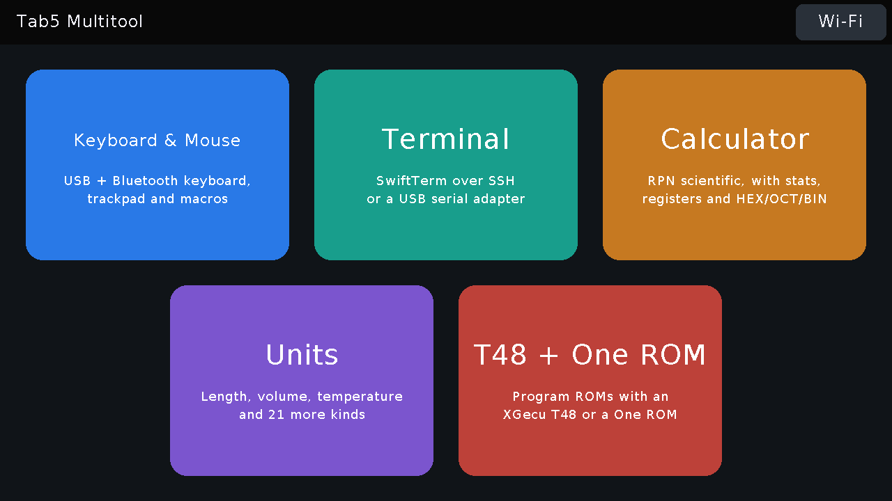
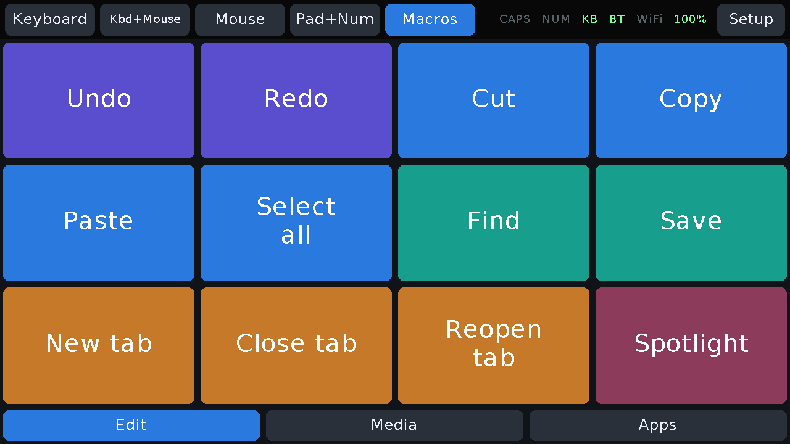

# Tab5 Multitool

The M5Stack Tab5, with or without its clip-on Tab5 Keyboard, as a set of
apps on one home screen:

| App | What it does |
|---|---|
| Keyboard & Mouse | a USB or Bluetooth keyboard, trackpad and macropad for another computer |
| Terminal | [SwiftTerm](https://github.com/migueldeicaza/SwiftTerm) (Embedded Swift) over SSH or a USB serial adapter |
| Calculator | an HP-style RPN scientific calculator: stack, registers, statistics, HEX/OCT/BIN |
| Units | unit conversion, 24 kinds; type "5 ft 3 in to cm" or "100 F in C" |
| T48 + One ROM | [T48 for Tab5](https://github.com/djb-rh/t48-for-tab5): program ROMs with an XGecu T48 or a One ROM |



**Install** from a desktop Chrome or Edge with the
[web installer](https://djb-rh.github.io/tab5-multitool/), then tap **Wi-Fi**
on the home screen to choose a network (the Terminal's SSH and the macro web
editor need one; T48 uses it too).

The keyboard and mouse part is also a library (`src/t5m`), so other Tab5
sketches can use any part of it.

**Licences.** The library and the Multitool's own code are MIT. The T48 app is
T48 for Tab5, which is GPL-3.0-or-later (it contains minipro), so the
firmware as built here, with it linked in, is distributed under GPL-3.0-or-later.

**Status: early (v0.1).** Everything here runs on a Tab5; see NOTES.md for what has been checked.
See [NOTES.md](NOTES.md) and [PLAN.md](PLAN.md).

## Library

```cpp
#include <Tab5Multitool.h>

t5m::UsbHid usb;                    // keyboard + mouse + media keys on USB-C
t5m::Trackpad pad(usb);
t5m::TrackpadRenderer padDraw;

void setup() {
  M5.begin();
  M5.Display.setRotation(3);
  usb.begin();
  pad.setRect({0, 0, 1280, 720});   // full-screen touchpad
}

void loop() {
  M5.update();
  t5m::TouchPoint t[t5m::kMaxTouches];
  pad.handle(t, t5m::readM5Touch(t), millis());
  padDraw.draw(M5.Display, pad);
}
```

| Piece | What it does |
|---|---|
| `UsbHid` | USB keyboard / mouse / media keys on USB-C (the P4's full-speed controller, so USB-A stays free), plus a CDC serial console |
| `BleHid` | the same over Bluetooth LE, through the Tab5's C6 (needs esp-hosted 2.x on the C6) |
| `HidFanout` | sends to both |
| `Tab5Keyboard` | the clip-on keyboard: real key up/down, Sym layer, status LEDs |
| `Keypad` | on-screen keyboards: QWERTY, Fn/symbols, numpad, nav/media |
| `Trackpad` | on-screen touchpad: tap, two-finger right-click and scroll, tap-drag, button strip |
| `KeyText` | key events → characters, for local text entry |
| `MacroLayout` / `MacroPad` / `MacroRunner` | macropad: JSON layouts, the button grid widget, and a non-blocking player |
| `RenderM5GFX` | default drawing for `Keypad` and `Trackpad` |

While `UsbHid` runs, `Serial` (USB-Serial-JTAG) is off the air. Use
`usb.console()` instead. `usb.end()` gives USB-C back.

## Macropad

Macros mode shows pages of buttons. Each button sends a key combo, some text, a
media key, a click, or a list of these with delays. Layouts are JSON, stored on
the Tab5 and edited in a browser at the Tab5's address (shown in Setup, and at
`http://tab5-multitool.local/`). The editor checks a layout before it saves it,
and it can download and upload layouts as files.

```json
{ "pages": [ { "name": "Shortcuts", "cols": 4, "rows": 3, "buttons": [
  { "label": "Copy", "color": "#2F7BD8", "do": "cmd+c" },
  { "label": "Sig", "do": "text:Thanks,\nDonnie\n" },
  { "label": "Vol +", "do": "media:volup" },
  { "label": "Term", "do": ["cmd+space", "delay:300", "text:Terminal\n"] }
] } ] }
```

The full step syntax is at the top of [src/t5m/Macro.h](src/t5m/Macro.h).



## Firmware

```bash
cd firmware && ~/.platformio/penv/bin/pio run -e app
```

The `app` build is for development: it waits 3 s on USB-Serial-JTAG at boot,
and if `firmware/include/secrets.h` exists (copy `secrets.h.example`) it joins
that Wi-Fi network while none is saved on the Tab5. The `release` build does
neither. `tools/release.sh v0.1.0` builds the release `.bin`, the T48 SD card
zip and the web installer site (`site/`, served from the gh-pages branch).

```bash
tools/flash.py app --wait
```

`flash.py` gets the Tab5 back onto USB-Serial-JTAG first, whatever it is doing.
`tools/shot.py out.png` saves a screenshot over the console. On the Mac,
`test/run.sh` tests the macro parser, `test/rpn_test.sh` the calculator,
`test/units_test.sh` the unit tables and parser, `test/term_test.sh` SwiftTerm.

The T48 app is built from the `third_party/t48-for-tab5` submodule
(`firmware/lib/t48`), which has its own minipro submodule, so clone with
`git clone --recursive` or run `git submodule update --init --recursive`. Its
Rust part needs rustup with the `riscv32imafc-unknown-none-elf` target.
